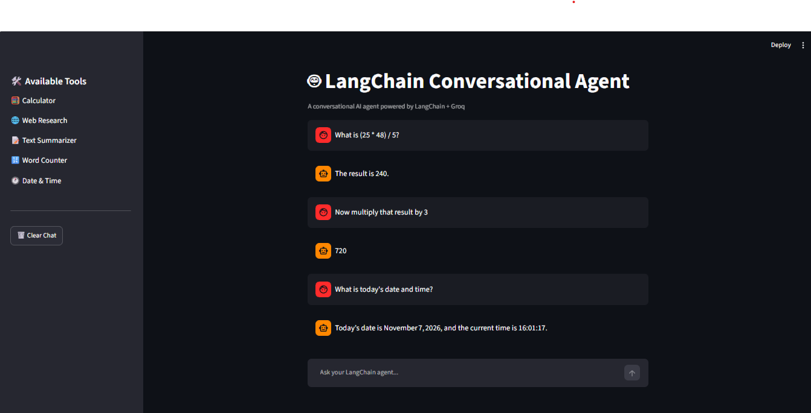
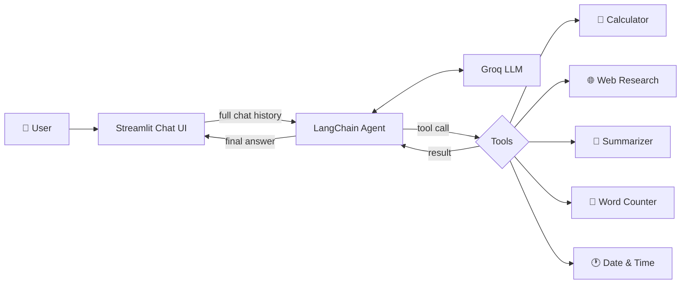

<div align="center">

# 🤖 LangChain Conversational Agent

**A tool-calling AI assistant that reasons, picks the right tool, and remembers your conversation.**

Built with LangChain · Groq · Streamlit


</div>

---

## 📸 Demo

<!-- Take a screenshot of your running app, save it as assets/demo.png, and it will show here -->


---

## ✨ Overview

This project is a conversational AI agent that goes beyond plain chat. Instead of answering everything from the model's memory, the agent **decides when a tool is needed**, calls it, reads the result, and then replies in natural language.

Ask it to do math, look up a topic, count words, or tell the time, and it routes the request to the right tool automatically.

### Highlights

- 🧠 **Agentic tool use**: the LLM chooses which tool to call and with what input
- 💬 **Multi-turn conversation**: the full chat history is passed to the agent on every turn
- ⚡ **Fast inference** with Groq (`openai/gpt-oss-20b`, temperature 0 for consistent answers)
- 🔒 **Safe calculator**: math is parsed with Python's `ast` module, never `eval()`
- 🎨 **Clean chat UI** with Streamlit, tool list sidebar, and a one-click Clear Chat
- 🛡️ **Error handling** for missing API keys and failed tool or API calls

---

## 🧰 Tools

| Tool | Description | Implementation |
|------|-------------|----------------|
| 🧮 **Calculator** | Evaluates expressions like `(100 + 50) / 5` or `2 ** 10` | AST-based safe evaluator supporting `+ - * / ** %` and negation |
| 🌐 **Web Research** | Fetches a factual summary of a topic | Wikipedia REST API |
| 📝 **Text Summarizer** | Condenses long text into a short summary | Extractive (leading sentences) |
| 🔢 **Word Counter** | Counts the words in any text | Python string processing |
| 🕐 **Date & Time** | Returns the current local date and time | `datetime` |

---

## 🏗️ How It Works



1. The user sends a message in the Streamlit chat.
2. The whole conversation is sent to the LangChain agent.
3. The Groq-hosted LLM decides whether to answer directly or call a tool.
4. Tool output is returned to the model, which writes the final answer.
5. The reply is shown in the chat and saved in the session history.

---

## 📁 Project Structure

```
langchain-conversational-agent/
├── app.py              # Streamlit UI, LLM setup, and agent creation
├── tools.py            # Custom LangChain tools
├── requirements.txt    # Python dependencies
├── .env.example        # Environment variable template
├── assets/
│   └── demo.png        # App screenshot
└── README.md
```

---

## 🚀 Getting Started

### Prerequisites

- Python 3.10 or higher
- A free Groq API key from [console.groq.com](https://console.groq.com)

### Installation

```bash
# 1. Clone the repository
git clone https://github.com/mehakrajpoot-codes/langchain-conversational-agent.git
cd langchain-conversational-agent

# 2. Create and activate a virtual environment
python -m venv venv
venv\Scripts\activate          # Windows
# source venv/bin/activate     # macOS / Linux

# 3. Install dependencies
pip install -r requirements.txt
```

### Configuration

Copy the example env file and add your key:

```bash
copy .env.example .env         # Windows
# cp .env.example .env         # macOS / Linux
```

```env
GROQ_API_KEY=your_groq_api_key_here
```

### Run

```bash
streamlit run app.py
```

The app opens at `http://localhost:8501`.

---

## 💡 Example Prompts

| Try this | Tool used |
|----------|-----------|
| `What is (25 * 48) / 5?` | Calculator |
| `Tell me about Alan Turing` | Web Research |
| `Summarize this: <paste a long paragraph>` | Text Summarizer |
| `How many words are in: "LangChain makes agents easy"` | Word Counter |
| `What is today's date and time?` | Date & Time |
| `Now multiply that result by 3` | Uses chat context + Calculator |

---

## 🧠 Design Decisions

- **No `eval()` in the calculator.** Expressions are parsed into an AST and only whitelisted operators are executed, so arbitrary code cannot run.
- **Stateless agent, stateful UI.** Conversation history lives in Streamlit's `session_state` and is sent to the agent on each turn, which keeps the agent simple and easy to test.
- **Secrets stay out of the code.** The API key is loaded from `.env`, and `.env` is git-ignored.
- **Deterministic answers.** Temperature is set to 0 so tool selection is consistent.

---

## 🗺️ Roadmap

- [ ] Replace the extractive summarizer with an LLM-based summarizer
- [ ] Add a live web search tool (e.g. Tavily) alongside Wikipedia
- [ ] Persist chat history across sessions
- [ ] Stream responses token by token
- [ ] Show which tool was called in the UI

---

## 🛠️ Tech Stack

| Layer | Technology |
|-------|------------|
| Language | Python |
| Agent framework | LangChain |
| LLM provider | Groq |
| Frontend | Streamlit |
| Data source | Wikipedia REST API |
| Config | python-dotenv |

---

## 👩‍💻 Author

**Mehak Fatima**
BSCS Student · Aspiring AI Engineer

[](https://github.com/mehakrajpoot-codes)

---

<div align="center">

⭐ If you found this project useful, consider giving it a star!

</div>
